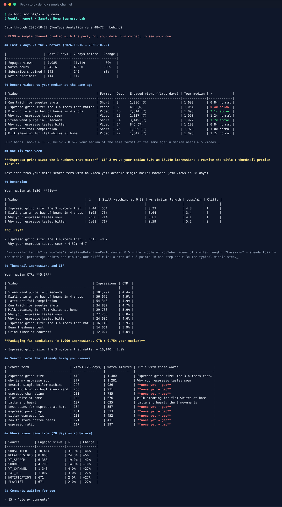

# YouTube Channel Operator — Lite (free)

**Your YouTube week in one command: last 7 days vs the 7 before, every new video vs your own median at the same age, and the one fix to make — computed from your own channel, not guessed by a prompt.**


<sub>Real run on the bundled **sample** channel (fictional data) · English · [Deutsch](README.de.md) · [Español](README.es.md) · [Português](README.pt.md) · [日本語](README.ja.md)</sub>

---

## Install in Claude Code (2 commands)

```
/plugin marketplace add jmshinhwa/youtube-channel-operator
/plugin install yt-operator-lite@readystack-youtube
```

Then just ask: **"show me a demo of the weekly YouTube report"** (no sign-in needed), and later **"connect my YouTube channel"**.

## What the scripts do (Claude only orchestrates)

| You say | Skill | What the script computes |
|---|---|---|
| "how is my channel doing?" | `weekly` | pulls your uploads + YouTube Analytics, compares the last 7 days with the 7 before, puts every video of the last 28 days next to **your median of the same format at the same age** (engaged views; Shorts and long-form apart) and picks **one fix** |
| "remember my channel style" | `profile` | `channel_profile.json`: your medians, upload gap, best weekdays, title length of your best quarter + your voice — every skill reuses it, so you never explain the channel twice |
| "make chapters" | `chapters` | chapter starts at real pauses of your transcript (.srt/.vtt) ≥ 10 s apart, then checks YouTube's rules (00:00 first, ≥ 3, ascending, ≥ 10 s) |
| "check my title" | `check` | title ≤ 100 characters, description ≤ 5,000 bytes, tags ≤ 500 counted YouTube's way (commas and the quotes around tags with spaces count), no `<` `>` |
| "connect my channel" | `connect` | read-only Google sign-in with **your own** OAuth client (PKCE, loopback) — [10-minute setup](plugins/yt-operator-lite/docs/SETUP.md) |

- **Your data stays on your computer** (`~/.youtube-operator`). Scopes: `youtube.readonly` + `yt-analytics.readonly` — it cannot upload, edit, comment or delete. `yto.py forget` deletes everything.
- **Python 3.9+ standard library only.** Nothing to `pip install`.
- **Light on tokens:** the scripts read the API data (≈ 149 KB of responses for a 60-video channel in our test) and hand Claude a ≈ 2.5 KB report.
- **Light on quota:** a weekly pull of 60 videos used **5** of the 10,000 daily Data API units in our test.
- **This year's rules:** comparisons use *engaged views* because YouTube now counts public views from the first frame (since 2026-08-27); queries end 3 days back because Analytics runs 48–72 h behind (both from YouTube's API revision history).
- Answers in **en · de · es · pt · ja** (`--lang`).

## Pro — the whole weekly job (12 skills)

Everything above, plus: **retention** of every recent video straight from Analytics (no Studio export) with the exact second people leave · **thumbnail CTR** from YouTube's reach report · **search terms that already bring you viewers but have no video yet** · **comment queue** (unanswered questions and requests first, reply drafts in your voice) · **rivals' outliers** (≥ 2× their own median) · **next week's plan** from your weekdays and capacity · **month review** with your saved weekly history.



→ https://getreadystack.com/apps/youtube-channel-operator-skill-pack/

## What it is not

It does not upload, post or edit anything, does not predict views, and does not scrape. Every number in a report comes from your own YouTube data (or the bundled sample in demo mode).

MIT · made by [ReadyStack](https://getreadystack.com) · not affiliated with YouTube or Google.
